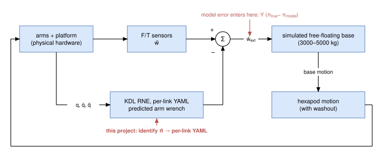
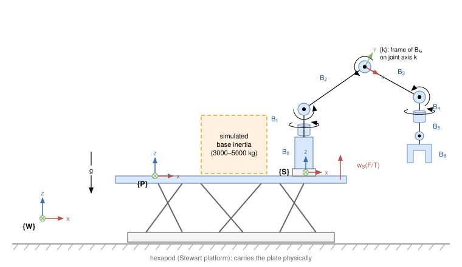
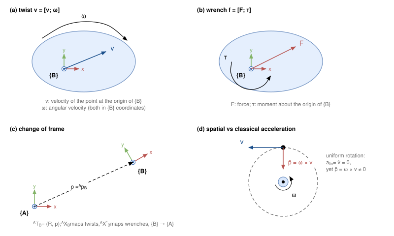
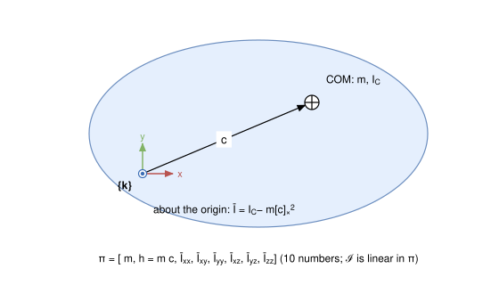
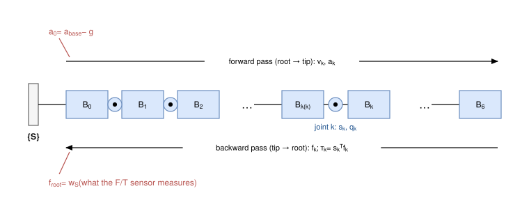
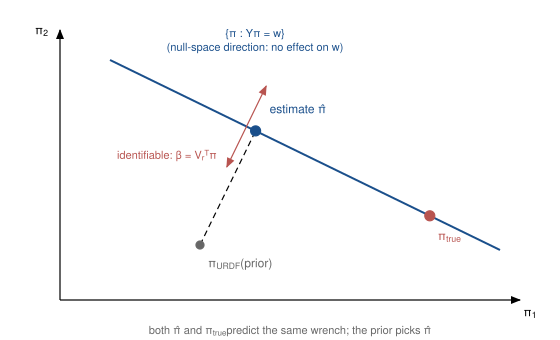
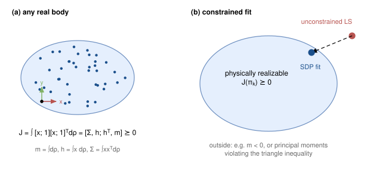
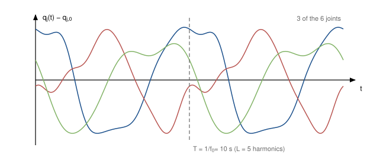
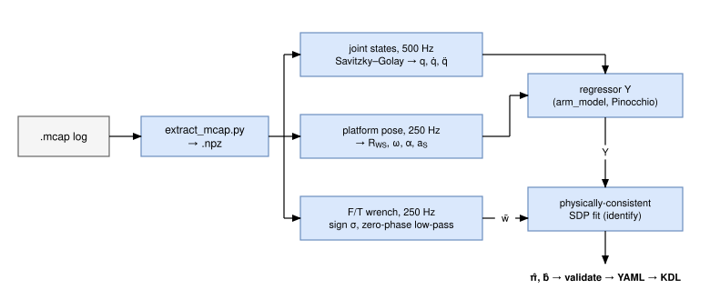

# Identifying manipulator inertial parameters from base F/T sensors on a hardware-in-the-loop free-floating testbed

_Working draft. Numbers are from the synthetic runs and the first hardware log listed in
LOG.md. Citations marked (verify) should be checked against the originals before use._

---

## 1. Introduction

On-orbit servicing and capture missions use robot arms mounted on a spacecraft that is
not fixed to anything. Every arm motion pushes the base. Testing this on the ground needs a
**hardware-in-the-loop (HIL)** testbed: real arms, real contact, and a simulated
free-floating base whose motion is reproduced by a motion platform.

On the RSS testbed, two UR20 arms (**han** and **chewie**) stand on a hexapod (Stewart
platform). Each arm sits on a 6-axis force/torque sensor (han: ATI Omega191; chewie: Bota
LAX triplet). The simulator loop is:

1. measure the wrench under each arm,
2. subtract what the arm's own motion and weight should produce (KDL recursive Newton–Euler,
   `ChainIdSolver_RNE`, with masses from a per-link YAML → URDF),
3. apply the remainder (contact and interaction forces) to a simulated free-floating base
   (e.g. a 3000 kg or 5000 kg target mockup),
4. command the hexapod to follow the simulated base motion (with washout).



*Figure 1. The hardware-in-the-loop simulator. The F/T sensors measure everything; KDL subtracts the arm's own predicted wrench; the remainder drives the simulated base, whose motion the hexapod reproduces. Any error in the arm's inertial model passes straight into the simulated base (red).*

Step 2 is only as good as the arm's inertial model. Any error goes straight into the
simulated spacecraft as a fake external force. The URDF used today is built from CAD, and it
**omits real hardware**: the wrist camera and its mount, cable harnesses, and the F/T sensor
bodies all have no mass in `sim_chaser.urdf`. The hardware team reports that gravity
compensation "isn't quite working". The first log (`junette_0_3000kg_0`) confirms it: after
chewie's reach, the compensated wrench settles at ≈ 3 N / 2 N·m instead of 0, even though
nothing is touching the arm.

This project identifies each arm's inertial parameters **from the same F/T sensors the
testbed already uses**. The result is an arm model whose predicted sensor wrench matches the
measured one, exported in the per-link form their KDL pipeline consumes.

## 2. Main references

**Classical identification (linear in the parameters, base parameters, excitation)**
- Atkeson, An & Hollerbach, "Estimation of inertial parameters of manipulator loads and
  links," *IJRR* 5(3), 1986. Dynamics are linear in 10 parameters per link; least squares.
- Gautier & Khalil, "Direct calculation of minimum set of inertial parameters of serial
  robots," *IEEE TRA* 6(3), 1990. Base (identifiable) parameters.
- Khalil & Dombre, *Modeling, Identification and Control of Robots*, 2002. Reference text.
- Swevers, Ganseman, Tükel, De Schutter & Van Brussel, "Optimal robot excitation and
  identification," *IEEE TRA* 13(5), 1997. Periodic Fourier excitation trajectories.

**Identification from base / external force measurements.** This is our measurement set-up.
- West, Papadopoulos, Dubowsky & Cheah, "A method for estimating the mass properties of a
  manipulator by measuring the reaction moments at its base," *ICRA* 1989.
- Raucent, Campion, Bastin, Samin & Willems, "Identification of the barycentric parameters
  of robot manipulators from external measurements," *Automatica* 28(5), 1992. (verify)

**Physical consistency**
- Sousa & Cortesão, "Physical feasibility of robot base inertial parameter identification:
  A linear matrix inequality approach," *IJRR* 33(6), 2014.
- Wensing, Kim & Slotine, "Linear matrix inequalities for physically consistent inertial
  parameter identification: A statistical perspective on the mass distribution," *IEEE
  RA-L* 3(1), 2018. The pseudo-inertia LMI used here.
- Traversaro, Brossette, Escande & Nori, "Identification of fully physical consistent
  inertial parameters using optimization on manifolds," *IROS* 2016. (verify)
- Lee, Wensing & Park, "Geometric robot dynamic identification: A convex programming
  approach," *IEEE T-RO* 36(2), 2020. Geometric (Riemannian) regularization toward a prior.

**Free-floating space robots and HIL**
- Umetani & Yoshida, "Resolved motion rate control of space manipulators with generalized
  Jacobian matrix," *IEEE TRA* 5(3), 1989.
- Dubowsky & Papadopoulos, "The kinematics, dynamics, and control of free-flying and
  free-floating space robotic systems," *IEEE TRA* 9(5), 1993.
- Boge & Ma, "Using advanced industrial robotics for spacecraft rendezvous and docking
  simulation," *ICRA* 2011. HIL with industrial robots. (verify)

**Algorithms and software**
- Featherstone, *Rigid Body Dynamics Algorithms*, Springer, 2008. RNEA, spatial algebra.
- Carpentier et al., "The Pinocchio C++ library," *IEEE/SICE SII* 2019. Regressors used here.
- Orocos KDL, `ChainIdSolver_RNE`. The hardware's inverse dynamics.

## 3. Preliminaries

This section fixes notation and collects the rigid-body and estimation results used in the
rest of the document.

**Spatial-vector ordering.** Spatial vectors are written **linear part first**, as in
Pinocchio and in the code. Featherstone (2008) and KDL's documentation put the angular part
first, so their matrices appear block-permuted relative to the ones here.

### 3.1 Notation and frames
- **{W}:** world frame, z up, gravity $g = [0,\,0,\,-9.81]^\top$ m/s².
- **{P}:** platform frame, `slide_optical_plate`. This is the free-floating base, carried
  physically by the hexapod.
- **{S}:** one arm's F/T sensor frame (`han_fts` or `chewie_fts_combined`).
- **{k}:** body frame of body $B_k$, i.e. the URDF link frame, with its origin on the axis
  of joint $k$.
- **Poses:** ${}^{A}R_{B}\in SO(3)$ and ${}^{A}p_{B}\in\mathbb R^3$ are the orientation and
  origin of {B} expressed in {A}; together they form ${}^{A}T_{B}\in SE(3)$.
- **Skew matrix:** $[x]_\times$ is defined by $[x]_\times y = x\times y$.
- **Joints:** $q\in\mathbb R^6$ are the arm joint angles in the order J1…J6
  (shoulder_pan, shoulder_lift, elbow, wrist_1, wrist_2, wrist_3), with rates $\dot q$ and
  accelerations $\ddot q$.



*Figure 2. Frames on the testbed (one arm shown; schematic, not to scale). {W} world with gravity g; {P} the platform carried by the hexapod; {S} the F/T sensor under the arm; B₀ the rigid stack from the sensor to the UR base; B₁…B₆ the links, each with frame {k} on its joint axis. The sensor measures w_S. ⊙ / ⊗: axis out of / into the page.*

### 3.2 Spatial vectors and transforms
**Twists and wrenches.** A body's twist is $v = [\nu;\,\omega]$:
- $\nu$ is the velocity of the point at the frame origin,
- $\omega$ is the angular velocity,
- both are expressed in the body frame.

A wrench is $f = [F;\,\tau]$: a force, and a moment about the frame origin.

**Transforms.** For ${}^{A}T_{B} = (R, p)$, twists and wrenches expressed in {B} map into
{A} by

$$
{}^{A}X_{B} = \begin{bmatrix} R & [p]_\times R \\ 0 & R \end{bmatrix},
\qquad
{}^{A}X^{*}_{B} = {}^{A}X_{B}^{-\top} = \begin{bmatrix} R & 0 \\ [p]_\times R & R \end{bmatrix}.
$$

**Cross products.** The motion and force cross products of a twist $v$ are

$$
v\times = \begin{bmatrix}[\omega]_\times & [\nu]_\times \\ 0 & [\omega]_\times\end{bmatrix},
\qquad
v\times^{*} = -(v\times)^\top = \begin{bmatrix}[\omega]_\times & 0 \\ [\nu]_\times & [\omega]_\times\end{bmatrix}.
$$

**Spatial vs classical acceleration.** RNEA works with the *spatial* acceleration
$a = \dot v$, the time derivative of the twist in body coordinates. The *classical*
acceleration of the frame origin is different:

$$
\ddot p = a_{\text{lin}} + \omega\times\nu .
$$

The two coincide only when $\omega = 0$ or $\nu = 0$. This distinction matters for the base
(induced) acceleration fed to KDL (§4.3). In Pinocchio, the classical acceleration is
`data.a[k].linear + ω × data.v[k].linear`.



*Figure 3. Spatial vectors. (a) A twist stacks the velocity of the frame origin and the angular velocity. (b) A wrench stacks the force and the moment about the frame origin. (c) A change of frame (R, p) maps twists with X and wrenches with X*. (d) A frame rotating uniformly about an external point has zero spatial acceleration, yet its origin has the centripetal classical acceleration ω × ν.*

### 3.3 Inertial parameters of one rigid body
Consider a body with mass $m$, centre of mass $c$ (in its frame) and rotational inertia
$I_C$ about the COM. Its rotational inertia about the frame origin follows from the parallel-
axis theorem, $\bar I = I_C - m[c]_\times^2$, and its spatial inertia is

$$
\mathcal I = \begin{bmatrix} m I_3 & -m[c]_\times \\ m[c]_\times & \bar I \end{bmatrix}.
$$

The body's momentum is $\mathcal I v$. The Newton–Euler equations give the net wrench
acting on the body:

$$
f = \mathcal I a + v\times^{*}\mathcal I v .
$$

**The linear parametrization.** This is the key step (Atkeson et al. 1986). Define the
10-vector

$$
\pi = [\,m,\; h_x,\; h_y,\; h_z,\; \bar I_{xx},\; \bar I_{xy},\; \bar I_{yy},\; \bar I_{xz},\; \bar I_{yz},\; \bar I_{zz}\,]^\top,
\qquad h = m c .
$$

$\mathcal I$ is **linear in $\pi$**: the product $m c$ appears only through $h$, and the
inertia only through $\bar I$. Hence, for any $v$ and $a$,

$$
\mathcal I a + v\times^{*}\mathcal I v = A(v, a)\,\pi, \qquad A\in\mathbb R^{6\times 10}
$$

(Pinocchio: `bodyRegressor`). The physical quantities are recovered from $\pi$ as
$c = h/m$ and $I_C = \bar I + m[c]_\times^2$.



*Figure 4. One rigid body. Its frame {k} sits on the joint axis; the COM is at c. Written about the frame origin, with h = m c and Ī, the 10 parameters enter the dynamics linearly.*

### 3.4 Recursive Newton–Euler (RNEA)
Consider a chain in which body $k$ has parent $\lambda(k)$ and joint $k$ has motion
subspace $s_k$. For a revolute joint about its local $z$ axis,
$s_k = [0,0,0,0,0,1]^\top$.

**Forward pass (root → tip).**

$$
v_k = {}^{k}X_{\lambda}\,v_{\lambda} + s_k\dot q_k,\qquad
a_k = {}^{k}X_{\lambda}\,a_{\lambda} + s_k\ddot q_k + v_k\times s_k\dot q_k .
$$

The root starts from the base's own twist and spatial acceleration, **minus gravity**:
$a_0 = a_{\text{base}} - {}^{0}X_{W}\,[g;\,0]$. Treating gravity as a fictitious upward
acceleration of the base removes every separate gravity term.

**Backward pass (tip → root).**

$$
f_k = \mathcal I_k a_k + v_k\times^{*}\mathcal I_k v_k + \sum_{c\,\in\,\text{children}(k)} {}^{k}X^{*}_{c} f_c,
\qquad \tau_k = s_k^\top f_k .
$$

**What the outputs mean here.** For a floating root, $f_{\text{root}}$ is the wrench the
mount exerts on the chain, i.e. the quantity the F/T sensor measures. KDL's
`ChainIdSolver_RNE` is exactly this recursion. The hardware's modified version:
- returns $f_{\text{root}}$ as `internal_wrenches[0]`,
- adds an "induced acceleration" to $a_0$,
- but starts $v_0$ from the joint velocity only, so the platform's angular velocity is
  dropped.

Every $f_k$ is a sum of terms $A(v_j, a_j)\pi_j$ mapped by constant-structure transforms,
so both outputs are linear in the stacked parameters:

$$
\tau = Y_\tau(q,\dot q,\ddot q)\,\pi,\qquad f_{\text{root}} = Y(q,\dot q,\ddot q)\,\pi .
$$

(Pinocchio: `computeJointTorqueRegressor`. With a free-flyer root, its first 6 rows are
$Y$ and the remaining rows are $Y_\tau$.)



*Figure 5. The RNEA recursion on one arm. Velocities and accelerations propagate from the sensor out to the tip, starting from the base acceleration minus gravity. Wrenches propagate back; each joint torque is the projection of its wrench on the joint axis, and the wrench at the root is what the F/T sensor measures.*

### 3.5 Floating-base equations of motion (context)
For the full system (base + both arms), with generalized velocity
$\nu = [\,v_{P};\,\dot q_{\text{han}};\,\dot q_{\text{chewie}}\,]$:

$$
M(q)\,\dot\nu + C(q,\nu)\,\nu + G(q) = S^\top\tau + \sum_i J_i^\top f_{\text{ext},i},
\qquad S = [\,0_{12\times 6}\;\; I_{12}\,].
$$

- The first 6 rows are the base's Newton–Euler equations. They are unactuated, so in orbit
  ($G = 0$, $f_{\text{ext}} = 0$) the total momentum is conserved.
- The HIL testbed splits these equations: the arms' rows are physical hardware, the base's
  rows are simulated.
- The two halves are coupled only through the measured base wrench minus the arm's
  predicted wrench. That split is why the arm's inertial model (this project) enters the
  simulated base dynamics directly.

### 3.6 Least squares, identifiability and conditioning
**Weighted least squares.** Stacking $N$ samples gives $Y\in\mathbb R^{6N\times 70}$ and
$w\in\mathbb R^{6N}$. With a noise covariance $\Sigma$ per sample, the estimate minimizes
$\|\Sigma^{-1/2}(Y\pi - w)\|^2$. At the solution, the covariance of the estimate is
$(Y^\top\Sigma^{-1}Y)^{-1}$ on the identifiable subspace.

**Identifiability.** Take the SVD $Y = U\,\mathrm{diag}(\sigma_i)\,V^\top$ and let $r$ be
its numerical rank.
- The data determine only $\beta = V_r^\top\pi$, the **base parameters**: $r$ linear
  combinations of $\pi$.
- Directions in the null space of $Y$ change $\pi$ without changing any prediction.
- Gautier & Khalil (1990) obtain an equivalent minimal set symbolically, or by QR with
  column pivoting.

**Conditioning.** The condition number $\kappa = \sigma_1/\sigma_r$ bounds how much relative
noise in $w$ can be amplified in $\beta$. Excitation design aims to make $\kappa$ small.

**Prior.** A regularizer $\lambda\|S^{-1}(\pi - \pi_0)\|^2$ with small $\lambda$ barely
affects $\beta$. Its job is to select, within the null space, the $\pi$ closest to the
prior $\pi_0$ (here the URDF).



*Figure 6. Identifiability in a 2-parameter cartoon. Every π on the blue line predicts the measured wrenches equally well; the data fix only the perpendicular (identifiable) direction. The prior selects the point closest to the URDF, which in general is not the true value: individual parameters are not measured, only their identifiable combinations.*

### 3.7 Physical consistency: the pseudo-inertia
Give a body a mass density $\rho$ over its frame coordinates $x$, and define its zeroth,
first and second moments $m = \int d\rho$, $h = \int x\,d\rho$ and
$\Sigma = \int x x^\top d\rho$. Its **pseudo-inertia** is

$$
J = \int \begin{bmatrix} x \\ 1\end{bmatrix}\begin{bmatrix} x \\ 1\end{bmatrix}^{\!\top} d\rho
  = \begin{bmatrix} \Sigma & h \\ h^\top & m \end{bmatrix},
\qquad \Sigma = \tfrac12\operatorname{tr}(\bar I)\,I_3 - \bar I \;\;\Longleftrightarrow\;\; \bar I = \operatorname{tr}(\Sigma)\,I_3 - \Sigma .
$$

- **Necessary:** every real mass distribution gives $J\succeq 0$.
- **Sufficient:** conversely, any $J\succ 0$ is realized by some distribution (Wensing et
  al. 2018).
- **Stronger than the naive checks:** $J\succeq 0$ is stronger than $m>0$ with $I_C\succ 0$.
  It also implies the triangle inequalities on the principal moments.
- **Convex:** $J$ is linear in $\pi$, so $J\succeq 0$ is a linear matrix inequality (LMI),
  and least squares under it is a convex semidefinite program.



*Figure 7. Physical consistency. (a) Any real mass distribution has a positive-semidefinite pseudo-inertia J. (b) Unconstrained least squares can land outside that set (negative mass, impossible inertia); the SDP fit returns the best physically realizable parameters instead.*

### 3.8 Signal conditioning
**Savitzky–Golay filter.** It fits a polynomial of order $p$ over a sliding window of $n$
samples and differentiates the polynomial analytically. That yields smoothed $q$, $\dot q$
and $\ddot q$ without the noise amplification of repeated finite differences.

**Zero-phase low-pass.** A Butterworth filter run forward and then backward (`filtfilt`)
has no phase lag. Its effective order is doubled and its effective cut-off is slightly
lower. Zero phase matters because the wrench and the joint signals must stay
time-aligned.

**Consistent filtering.** Ideally the regressor and the wrench pass through the same
filter. Here the cut-offs (15 Hz low-pass; the Savitzky–Golay bandwidth) sit far above the
motion bandwidth (≲ 1 Hz), so the mismatch is negligible.

### 3.9 Periodic excitation trajectories
Following Swevers et al. (1997), each joint follows a finite Fourier series with base
frequency $\omega_f = 2\pi f_0$:

$$
q_j(t) = q_{j,0} + \sum_{l=1}^{L}\left[\frac{a_{jl}}{\omega_f l}\sin(\omega_f l t) - \frac{b_{jl}}{\omega_f l}\cos(\omega_f l t)\right].
$$

- **Why this form:** the trajectory is periodic (so it can be averaged over periods), its
  derivatives are analytic, and its frequency content is bounded by $L f_0$.
- **Choosing the coefficients:** $a_{jl}$ and $b_{jl}$ are optimized to minimize $\kappa(Y)$
  (or maximize $\log\det Y^\top\Sigma^{-1}Y$), subject to joint position, velocity and
  acceleration limits, self-collision limits and platform limits.



*Figure 8. Example Fourier excitation (random coefficients, 3 of the 6 joints, two periods). Optimized coefficients would additionally minimize the regressor's condition number.*

## 4. Problem

### 4.1 System
For one arm, cut the robot at its F/T sensor. Everything above the sensor is a floating
serial chain of 7 rigid bodies:

- **B0:** the rigid stack between the sensor and the UR base (han: ATI adapter + tombstone
  + UR base; chewie: Bota top plate + tombstone + UR base). URDF masses: 10.57 kg (han) and
  18.72 kg (chewie).
- **B1…B6:** the UR20 links moved by joints J1…J6. Fixed-joint children are merged into
  the body they hang from (mount adapter, gripper adapter and Zimmer gripper → B6).

The sensor frame {S} moves with the platform: orientation R_WS(t), angular velocity ω,
angular acceleration α, and linear acceleration of its origin a_S. The arm joints give
q, q̇, q̈ ∈ ℝ⁶.

### 4.2 Measurement model
Newton–Euler for every body above the sensor (§3.3–3.4), summed and expressed in {S}, gives
the wrench the mount applies to the arm:

$$
w_S \;=\; \sum_{k=0}^{6} {}^{S}X_k^{*}\,\big( \mathcal I_k\, a_k + v_k \times^{*} \mathcal I_k\, v_k \big),
$$

where v_k and a_k are each body's spatial velocity and acceleration. Gravity enters as a
fictitious upward acceleration of the base, a_k ← a_k − g. Each spatial inertia 𝓘_k is
linear in the 10-vector

$$
\pi_k = [\,m,\; m c_x,\; m c_y,\; m c_z,\; I_{xx},\; I_{xy},\; I_{yy},\; I_{xz},\; I_{yz},\; I_{zz}\,]^{\top}
$$

(inertia about the body-frame origin), so

$$
w_S = Y\big(q,\dot q,\ddot q,\; R_{WS},\,\omega,\,\alpha,\,a_S\big)\,\pi, \qquad
\pi = [\pi_0^\top \dots \pi_6^\top]^\top \in \mathbb R^{70}.
$$

The sensor reads

$$
\tilde w = \sigma\, w_S + b + \varepsilon, \qquad \sigma\in\{+1,-1\},
$$

with an unknown constant bias b (tare drift) and noise ε. The sign σ depends on the sensor
convention (mount-on-arm vs arm-on-mount).

**In code:** Pinocchio model with a free-flyer root at {S}; Y = the first 6 rows of
`computeJointTorqueRegressor` (`arm_model.ArmFT.regressor`).

### 4.3 What the testbed does today, and why it fails
The testbed computes ŵ_ext = w̃ − KDL_RNE(q, q̇, q̈; π_URDF), tared at start-up. With the
arm at rest and no contact:

$$
\hat w_{ext} = Y_g(q, R_{WS})\,(\pi_{true} - \pi_{URDF}) \;+\; (\text{bias drift}),
$$

a **pose- and tilt-dependent** error. It cannot be tared away, because it changes whenever
the arm moves or the hexapod tilts. The first log shows exactly this:

- **chewie:** the residual settles at a new non-zero value after its reach.
- **han:** han hardly moved, but its residual shifted by ~2 N when the platform tilted 5°.

During motion the residual reaches ±15–20 N·m. That adds inertial model error and possibly
F/T–joint latency on top.

**Secondary model gaps in the modified KDL solver.** Worth quantifying, not necessarily
fixing:
- the root velocity `v[0]` ignores the platform's angular velocity;
- the induced (base) acceleration is added as a twist at the root, which is only
  equivalent to the physical base acceleration if spatial vs point acceleration is
  handled consistently.

### 4.4 Identifiability
Not all 70 parameters affect w_S. Stacking many samples, the SVD of Y shows **rank 52**
(numerically, both arms, with platform tilt ±5°). Consequences:

- The *wrench* is fully determined by 52 base-parameter combinations. That is all the
  base-wrench prediction needs.
- *Individual* link masses, COMs and inertias are not unique. Any π that matches the 52
  combinations predicts the same sensor wrench.
- Joint torques τ = rows 7–12 of the full regressor depend on *different* combinations,
  some of which the F/T sensor cannot see.

## 5. Proposed method

### 5.1 Data pipeline
1. **Extract** straight from the `.mcap` (`extract_mcap.py`). The CSV exports truncate
   multi-shape messages.
2. **Time base:** the logger clock. Header stamps agree to ≤ 0.1 ms. Evaluate everything on
   the F/T timestamps (250 Hz).
3. **Joints:** Savitzky–Golay smoothing and derivatives of q (500 Hz, 80 ms window, order
   3) for q̇ and q̈. The measured q̇ is available for cross-checks.
4. **Platform:** pose → R_WS, ω, α, a_S through the fixed plate→sensor transform. Needs
   confirmation of which topic is the *physical* platform pose, and its units.
5. **Wrench:** zero-phase 4th-order Butterworth low-pass (15 Hz). Correct the sign σ.



*Figure 9. The data pipeline from a hardware log to parameters the testbed can use.*

### 5.2 Estimator
A weighted, physically consistent least squares with a weak prior:

$$
\min_{\pi,\,b}\;\; \frac1N\sum_{i=1}^{N}\big\|\Sigma^{-1/2}\big(Y_i\pi + b - \tilde w_i\big)\big\|^2
\;+\; \lambda\,\big\|S^{-1}(\pi-\pi_{URDF})\big\|^2
\quad\text{s.t.}\quad J(\pi_k)\succeq \epsilon I_4,\;\; k=0\dots6,
$$

**Pseudo-inertia.** For each body,

$$
J(\pi_k)=\begin{bmatrix}\tfrac12\operatorname{tr}(\bar I)\,I_3-\bar I & h\\ h^\top & m\end{bmatrix},
\qquad h = m c,
$$

with Ī the rotational inertia about the body-frame origin. J ⪰ 0 is equivalent to the
body being a physically realizable mass distribution (§3.7; Wensing et al. 2018).

**Settings:**
- Σ whitens force vs torque noise.
- S scales each parameter type.
- λ = 1e-3 only resolves the 18 unidentifiable directions toward the URDF.
- The problem is a small SDP (76 variables, 7 LMIs of size 4). The data term is compressed
  by QR, so thousands of samples cost nothing. Solved with Clarabel via cvxpy
  (`identify.fit_consistent`).
- `identify.fit_ols` (unconstrained) is kept for diagnostics only.

### 5.3 Experiments
- **Stage A, static (gravity).** 20–30 arm poses, each held ~2 s, ideally at two or more
  platform tilts. Identifies the gravity-relevant combinations (m, m·c). This is the
  direct fix for gravity compensation, and cheap to run.
- **Stage B, dynamic (inertia).** Periodic Fourier excitation (§3.9; Swevers et al. 1997).
  - Five harmonics of f₀ = 0.1 Hz.
  - Coefficients optimized to minimize the condition number (or maximize log det) of the
    stacked, whitened regressor.
  - Constraints: joint position, velocity and acceleration limits, self-collision and
    platform limits.
  - Periodicity allows averaging over periods to reduce noise.
- **Stage C, validation.** Predict the wrench on held-out runs (e.g. `rss_reach.py`
  captures at several base masses). Compare the RMS residual against the URDF baseline and
  the sensor noise floor.
- **Stage D, export.** Write per-body parameters into the collaborator's per-link YAML →
  URDF → KDL.
  - B6 absorbs the camera and adapters.
  - B0 is only needed if their chain starts at the sensor frame.
  - Caveat: the per-link values are one valid representative, so they are good for the
    base wrench but not guaranteed for joint torques (§4.4).
- **Stage E (optional), joint torques.** Add the UR `effort` signals (500 Hz, already
  logged) as extra rows τ = Y_τ π + friction(q̇). This raises the rank beyond 52 and pins
  down link parameters that matter for joint-level control.

### 5.4 Verification before trusting hardware fits
1. **Synthetic end to end** (`test_synthetic.py`): simulate a known "true" arm, log it like
   the hardware, run the identical pipeline, recover it.
2. **KDL equivalence:** reproduce their `internal_wrenches[0]` with Pinocchio from the
   same inputs, sample by sample. This needs their predicted wrench logged.
3. **Residual test on existing logs:** fit only the before/after rest windows of
   `junette_0_3000kg_0`. This is a sanity check (two poses per arm), not an identification.

## 6. Results so far

### 6.1 Synthetic (`synth-v2`, seed 1)
The truth is the URDF plus:
- unmodelled masses: 0.3 kg on the sensor stack, 0.9 kg upper-arm harness, 0.5 kg forearm
  harness, 0.4 kg camera on wrist_3;
- ±5% random mass/inertia error and 5 mm COM error per body.

The simulated logs are F/T at 250 Hz (0.5 N / 0.05 N·m noise, unknown bias) and joints at
500 Hz (2e-5 rad noise), with platform tilt ±5°.

Held-out 20 s trajectory, wrench RMS on the worst axis:

| | chewie | han |
|---|---|---|
| noise floor (true params) | 0.51 N / 0.52 N·m | 0.68 N / 0.44 N·m |
| URDF (as used today, tared) | 1.52 N / 5.24 N·m | 1.36 N / 2.47 N·m |
| identified, static only (Stage A) | 0.51 N / 4.47 N·m | 0.68 N / 2.81 N·m |
| identified, static + 30 s excitation (A+B) | **0.51 N / 0.52 N·m** | **0.68 N / 0.44 N·m** |

- **Rank:** 52 / 70. Whitened condition number: 1.5e5 static only, 3.5e4 with random
  excitation (not yet optimized).
- **Bias:** recovered to ≤ 0.07 N.
- **Static only** fixes the gravity part (forces at the noise floor) but not the torques
  during motion. The excitation stage is required for dynamic accuracy.
- **Per-link parameters are not unique.** On chewie the identified per-body COMs were
  further from the truth than the URDF's (11–47 mm), while the wrench prediction was
  perfect. On han they mostly improved. This is the non-uniqueness of §4.4, not a bug.

### 6.2 Hardware (`junette_0_3000kg_0`, one run)
- **Recorded:** full joint states for both arms (with effort), the three compensated
  wrenches, the platform state and `/tf`. **No raw F/T.**
- **Measured residual error** of today's compensation: ≈ 3 N / 2 N·m at rest after the
  motion, and up to ±20 N·m during it.
- **Not yet fitted.** Blocked on raw F/T, the platform-pose definition, the sign
  convention, the KDL chain root and the YAML (see the root `CLAUDE.md`, Current state).

## 7. Open questions
1. Which signal is the physical platform pose: `/rss/slide_platform_state` or the hexapod
   `/tf`, before or after washout? What units?
2. Sensor wrench sign and frame. Is the raw F/T published, and at what rate?
3. KDL chain root: the sensor frame or the UR base? That decides whether B0 is part of
   their model.
4. What exactly is passed to `setInducedAcceleration`, and in which frame?
5. How large is the F/T–joint-state latency? Estimate by cross-correlation on a dynamic run.
6. Do they also use KDL joint torques for control? If yes, Stage E becomes necessary.

## Appendix: code

| file | role |
|---|---|
| `extract_mcap.py` | `.mcap` → `.npz` time series |
| `arm_model.py` | Pinocchio model rooted at the F/T sensor; wrench, regressor, pseudo-inertia |
| `preprocess.py` | low-pass, Savitzky–Golay derivatives, resampling |
| `identify.py` | identifiability (SVD), least squares, physically-consistent SDP fit |
| `test_synthetic.py` | synthetic end-to-end test (§5.4.1, §6.1) |
| `figures/make_figures.py` | the README figures: `figures.drawio` (editable, one page each) + SVGs |

```
conda activate croc_crabs            # env from ../croc_crabs.yaml
python sysid/extract_mcap.py rss_platform/mcap_data/<run>/<run>.mcap
python sysid/test_synthetic.py --arm chewie --plot synth.png
python sysid/figures/make_figures.py     # regenerate the figures
```
